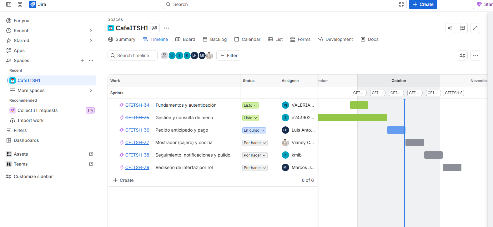
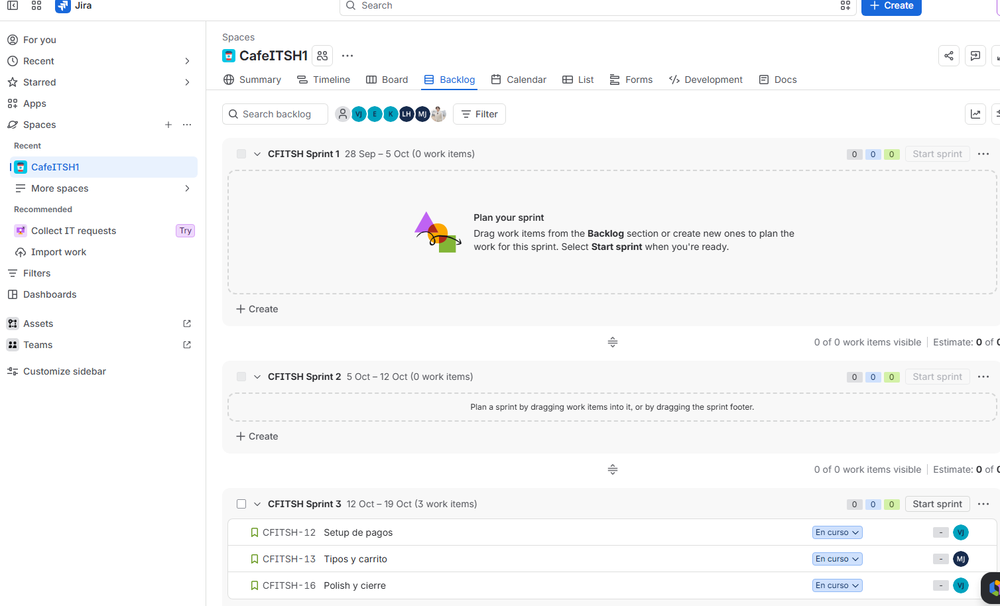
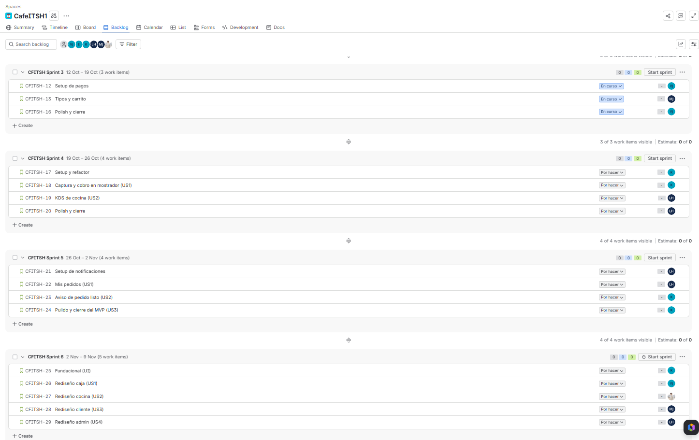
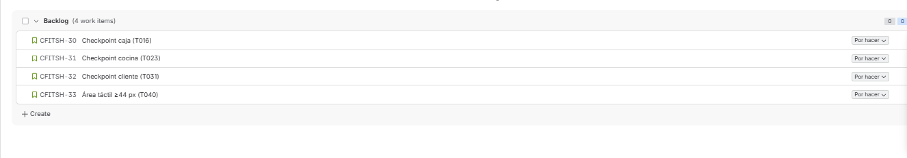
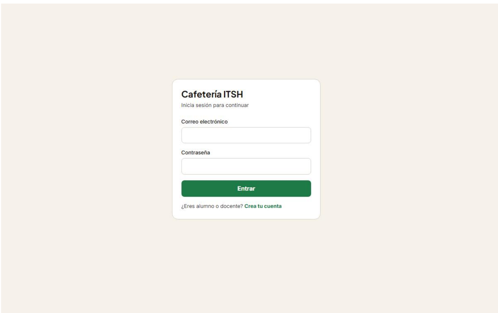
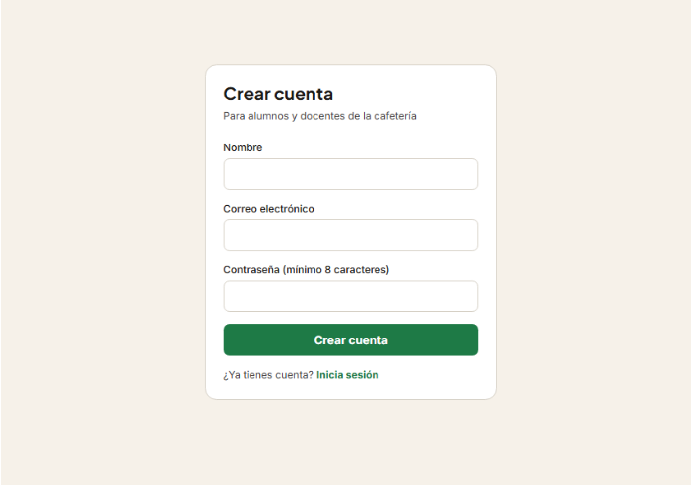
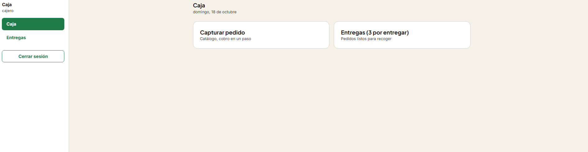
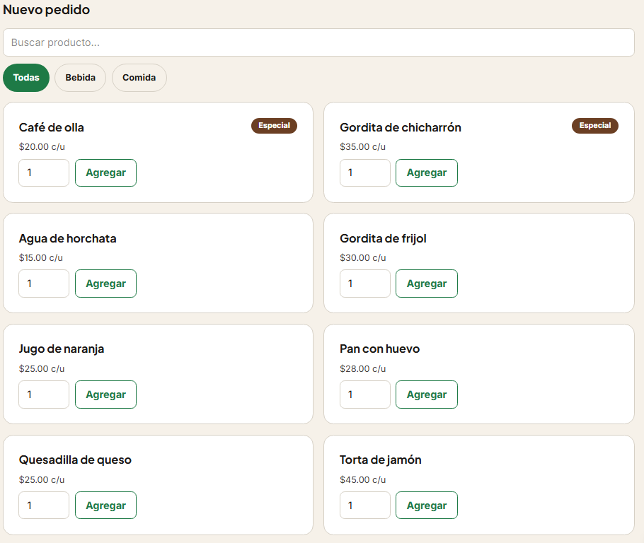
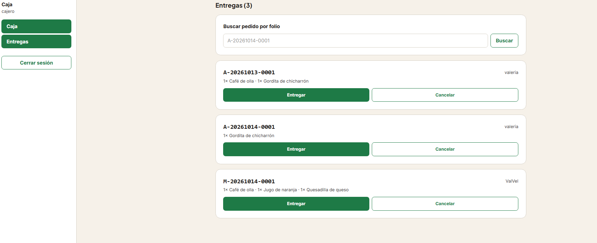
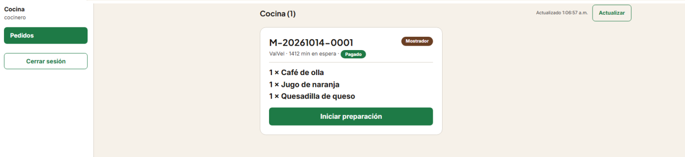

# REPORTE INDIVIDUAL — SDD CON SPEC KIT

## DATOS DE LA ENTREGA

| Campo | Mi respuesta |
|---|---|
| Alumno | Valeria Herrera Juarez |
| Equipo y proyecto | Sistema de Pedidos Anticipados — Cafetería ITSH. Luis Antonio de la Cruz Hernández (Agile Enabler), Karla Marlen Luna Bazán (Product Architect), Valeria Herrera Juarez, Marcos Jared Ramirez Bautista y Frida Anahi Morales Olivares (Product Builder) |
| Mi porción | Inicio de sesión (US6, Sprint 1) y Caja (US4, Sprints 4 y 6) |
| Repositorio | https://github.com/LeriVal/CafeItsh.git |
| Rama | `main` (única rama, sin squash ni force-push) |
| Herramienta de IA | OpenCode con Spec Kit (comandos `speckit.*` instalados en `.opencode/commands/`) |

**Commits de la rama (ID corto):**

| Commit | Fecha | Contenido |
|---|---|---|
| bfbb2bf | 13-oct | Constitution, specs 001 y 002 y plan del sprint 1 |
| c1bf49b | 13-oct | Sprint 1: backend de autenticación (JWT, usuarios operativos, corredor de migraciones) |
| 6a51261 | 13-oct | Sprint 1: frontend con login, rutas por rol y admin de operativos |
| ed97e69 | 13-oct | Fix: CORS solo para el origen del frontend |
| 2cb5a5c, 1976cc7, 523881f | 13-oct | Sprint 2: spec, API de menú, admin y consulta |
| 5db6d23, 89c6fc7, 9367c41 | 13-oct | Sprint 3: spec, pedidos anticipados con pago simulado, carrito y confirmación |
| 191b74a | 13-oct | Spec, plan y tareas del sprint 4 (mostrador y cocina) |
| ca031ca | 13-oct | Sprint 4: mostrador, cola de cocina, entregas y matriz de permisos |
| 7a1c477 | 13-oct | Sprint 4: páginas de caja y cocina con sondeo |
| 836c67a | 13-oct | `AGENTS.md` con la guía operativa del repo |
| f9dc931 | 13-oct | Sprint 5: seguimiento, avisos de listo y badge de estados |
| d2cc55f | 14-oct | Sprint 6: rediseño UI por rol (drawer, bottom bar, caja en subrutas) |
| 9395140 | 14-oct | Caja: buscar por folio, detalle en entregas, quitar en resumen y avisos |
| 3844f19 | 14-oct | Fix: las subrutas `/caja/*` daban 404, con prueba de regresión |
| e8069e8 | 18-oct | Tareas marcadas como completadas (sprints 1 a 6) |
| 91ee68d | 18-oct | Criterios de aceptación en EARS en los specs 002 (login) y 005 (caja) |
| 4528d56 | 18-oct | Diagrama ER del esquema completo |
| d9a9ad7 | 18-oct | Capturas, salida de pruebas y trazabilidad en `docs/evidencias/` |

---

## APARTADO 0 — ÍNDICE DE EVIDENCIAS

Rama única `main`, sin squash ni force-push: el historial muestra el orden real. Los enlaces con hash apuntan a la versión exacta del archivo en ese commit (`https://github.com/LeriVal/CafeItsh/blob/<hash>/<ruta>`).

| Apartado | Evidencia | Commit |
|---|---|---|
| 1. Contexto y constitution | `.specify/memory/constitution.md` | bfbb2bf |
| 2. Spec maestra | `specs/001-pedidos-anticipados-cafeteria/spec.md` | bfbb2bf |
| 2. Spec del sprint 1 (login) | `specs/002-foundation-auth/spec.md` | bfbb2bf |
| 2. Spec del sprint 4 (caja y cocina) | `specs/005-counter-kitchen/spec.md` | 191b74a |
| 2. Spec del sprint 6 (rediseño) | `specs/007-ui-redesign/spec.md` | d2cc55f |
| 2. Specs 002 y 005 con EARS | sección «Criterios de aceptación en EARS» | 91ee68d |
| 2. Calidad de los specs | `specs/00X-*/checklists/requirements.md` | bfbb2bf … d2cc55f |
| 3. Plan técnico | `specs/00X-*/plan.md`, `research.md`, `contracts/` | bfbb2bf … d2cc55f |
| 4. Modelo de datos | `specs/00X-*/data-model.md` y diagrama ER en `specs/002-foundation-auth/data-model.md` | bfbb2bf … d2cc55f; 4528d56 |
| 4. Migraciones reales | `migrations/001`–`004` | bfbb2bf (001, 002), c1bf49b (003), f9dc931 (004) |
| 5. Tareas | `specs/00X-*/tasks.md` con casillas `[x]` | e8069e8 |
| 5 y 6. Trazabilidad y pruebas | `docs/evidencias/trazabilidad.md`, `pruebas-backend-vitest.txt`, `pruebas-frontend-vitest.txt` | d9a9ad7 |
| 6. Implementación | Historial de commits de c1bf49b a 3844f19 | ver apartado 6 |
| 6. Capturas | `docs/evidencias/captura-*.png` | d9a9ad7 |
| 7. EARS | secciones EARS de los specs 002 y 005 | 91ee68d |

---

## APARTADO 1 — CONTEXTO Y CONSTITUTION

### Qué problema resuelve
Durante los recesos de la cafetería del Instituto Tecnológico Superior de Huauchinango (ITSH) se forman filas largas y los pedidos se toman de forma verbal, lo que genera errores. El sistema permite que alumnos y docentes consulten el menú, pidan y paguen por adelantado (con al menos 10 minutos de anticipación) y reciban un aviso cuando su pedido esté listo, sin interrumpir el servicio actual de mostrador. Los objetivos medibles son reducir al menos 50 % la espera en caja en recesos, lograr que el 100 % de los pedidos anticipados cumpla los 10 minutos y reducir los errores por interpretación verbal.

### Proyecto
Sistema web de pedidos anticipados con una sola aplicación y rutas por rol: administrador (`/admin`), cajero (`/caja`), cocinero (`/cocina`) y cliente alumno o docente (`/menu`, `/mis-pedidos`). El MVP se construyó en 6 sprints: (1) fundamentos y autenticación, (2) menú, (3) pedido anticipado y pago, (4) mostrador y cocina, (5) seguimiento y notificaciones, (6) rediseño de la interfaz por rol. **Mi porción** es el inicio de sesión (Sprint 1) y la caja (Sprints 4 y 6).

### Principios de la constitution (v1.0.0, 7 principios)

| # | Principio | Qué dice | Por qué lo elegimos |
|---|---|---|---|
| I | Alcance MVP primero (no negociable) | Nada fuera del MVP sin aprobación; sin reseñas, inventario ni lealtad | Proyecto académico con poco tiempo y presupuesto; el riesgo principal es desviarse |
| II | Seguridad por defecto (no negociable) | JWT y roles en cada ruta, contraseñas con hash, secretos en variables de entorno, sin datos de tarjeta, HTTPS en producción | Se manejan credenciales, pagos y datos de alumnos y docentes |
| III | Simplicidad y mantenibilidad | TypeScript estricto, capas `routes → controllers → services`, sin ORM, sin dependencias innecesarias | El equipo es pequeño y rota; lo simple se prueba y se mantiene |
| IV | Rapidez operativa en receso | Pocos pasos, área táctil de 44 px mínimo, alto contraste, diseño responsivo | En recesos cada segundo en caja y cocina cuenta |
| V | Trazabilidad total del pedido | Seis estados explícitos y anticipación mínima de 10 minutos | Sin estados visibles no se puede auditar ni probar el progreso |
| VI | Validación estricta y errores seguros (no negociable) | Validar en frontend y backend, API REST con códigos correctos, sin stack traces | Es la frontera entre un fallo menor y una filtración o corrupción de datos |
| VII | Viabilidad económica | Ejecución local y hosting gratuito o barato | Si no es barato y rápido, la cafetería no lo adopta |

### Stack obligatorio y desviaciones
- **Stack:** React + TypeScript + Vite; Node.js + Express; MySQL 8.0; pruebas con Vitest.
- **Se cumple:** stack, seguridad, estados del pedido y pruebas de lo crítico.
- **Desviaciones** (reconocidas, no corregidas para no mover el código): la constitution menciona shadcn/ui y una estructura `database/` y `tests/` en la raíz, pero el proyecto usa Tailwind v4 sin shadcn (diferido en `002/research.md` R8) y tiene `migrations/` y los tests dentro de `backend/` y `frontend/`. Los tokens de diseño están en `docs/DESIGN.md` y no en `.stitch/DESIGN.md`.
- **Gobernanza:** versionado semántico; ratificada el 2026-10-13 sin enmiendas posteriores.

### Evidencia
`.specify/memory/constitution.md` (194 líneas), creada en el commit bfbb2bf; no ha cambiado después. La fuente de detalle es `docs/reglas (1).md`.

---

## APARTADO 2 — SPEC

Una spec maestra (`001`) y una spec por sprint (`002` a `007`), en español. Cada spec de sprint recorta la maestra con trazabilidad a sus historias y requisitos. Trae historias con prioridad, escenarios Given/When/Then, casos límite, requisitos funcionales (FR), criterios de éxito (SC), suposiciones y entidades.

| Carpeta | Sprint | Qué cubre |
|---|---|---|
| `specs/001-pedidos-anticipados-cafeteria` | Maestra | 6 historias, 29 FR, 8 SC |
| `specs/002-foundation-auth` | 1 | Login, rutas protegidas, registro y usuarios operativos |
| `specs/003-menu-management` | 2 | Menú y platillos |
| `specs/004-advance-orders-payment` | 3 | Pedido anticipado y pago |
| `specs/005-counter-kitchen` | 4 | Mostrador (caja) y cocina |
| `specs/006-order-tracking-notifications` | 5 | Seguimiento y avisos |
| `specs/007-ui-redesign` | 6 | Rediseño de la interfaz por rol |

### Ejemplo de mi porción
- **Historia (US4):** «Como cajero, quiero capturar pedidos presenciales con cobro en pocos pasos, mientras los pedidos anticipados siguen fluyendo, para no interrumpir el mostrador en el receso.»
- **Criterio (spec 005):** *Given* un monto recibido menor al total, *When* se intenta confirmar, *Then* se rechaza con mensaje claro sin crear el pedido.
- **Criterio (spec 002):** *Given* cualquier cuenta, *When* intenta iniciar sesión con contraseña incorrecta, *Then* ve un mensaje claro de credenciales inválidas que no revela si la cuenta existe.
- **Casos límite de la maestra:** pago fallido, platillo agotado entre consulta y confirmación, transición de estado inválida, cancelación tardía, conectividad intermitente y dos operadores sobre el mismo pedido.

### Ambigüedades resueltas
No se ejecutó `/speckit.clarify`. Las ambigüedades se resolvieron al redactar los specs y los planes, y quedaron documentadas:
- **Sprint 1 (login):** el registro público solo crea clientes (`usuario`); un correo duplicado devuelve 409; la sesión es un JWT de 8 h que el backend revalida en cada petición, de modo que desactivar una cuenta o cambiarle el rol surte efecto de inmediato (`002/research.md` R4 y `data-model.md`).
- **Sprint 4 (caja):** el pedido de mostrador nace `Pagado` en una sola transacción y el cambio se calcula, no se guarda (`005/research.md` R2 y R7).
- **Sprint 6:** la conciliación C1 a C6 entre los documentos de diseño y el código real (cantidad máxima 20 y no 99, sondeo de 10 s y no 4 s, rutas actuales, sin «cancelar pedido» del cliente, carrito persistente, hora de recogida en cocina).

### Versiones del spec
| Versión | Qué cambió | Commit |
|---|---|---|
| Inicial (spec 002, login) | Historias, escenarios Given/When/Then y 9 FR | bfbb2bf |
| Con criterios EARS (spec 002) | Sección «Criterios de aceptación en EARS» con 7 criterios (EARS-001 a EARS-007) | 91ee68d |
| Inicial (spec 005, caja y cocina) | Historias, escenarios y FR | 191b74a |
| Con criterios EARS (spec 005) | Sección «Criterios de aceptación en EARS» con 7 criterios | 91ee68d |
| Spec 007 (rediseño) | Agrega decisiones de conciliación C1 a C6 frente a `desing/` | d2cc55f |

### Calidad y límites
Cada sprint tiene `checklists/requirements.md`. Cada spec declara lo que queda fuera (p. ej. FR-009 del spec 002: sin menú, pedidos, pagos ni notificaciones; FR-008 del spec 007: nada marcado «fuera de alcance» en `desing/`). Los specs conservan la etiqueta «Draft» en su encabezado, aunque están implementados.

### Evidencia
`specs/00X-*/spec.md` y `checklists/requirements.md`. Commits bfbb2bf, 191b74a, d2cc55f y 91ee68d.

---

## APARTADO 3 — PLAN TÉCNICO

### Arquitectura y stack
- Monorepo con `frontend/` y `backend/` y una base MySQL 8.0 con migraciones numeradas en `migrations/`.
- **Frontend:** React 19, TypeScript estricto, Vite, Tailwind v4 y React Router 7; una sola app con rutas protegidas por rol (`ProtectedRoute`).
- **Backend:** Node.js con Express 5 y `mysql2/promise` sin ORM; capas `routes/` → `controllers/` → `services/`, más `middlewares/` y `utils/`.
- **Seguridad:** JWT con `requireAuth` y `requireRole`, contraseñas con `bcryptjs`, CORS con allowlist en `FRONTEND_URL`.
- **Pruebas:** Vitest en ambos paquetes (backend con una MySQL compartida y ejecución en serie; frontend con jsdom).
- **Pagos:** proveedor simulado detrás de la interfaz `ProveedorPago`; la API rechaza cualquier campo de tarjeta (`CARD_DATA_FORBIDDEN`).

### Decisiones y alternativas descartadas (`research.md`)

| Decisión | Se descartó |
|---|---|
| S1 R2: TypeScript con `tsx` y sin ORM | Prisma o Drizzle (sobreingeniería para el MVP) |
| S1 R3: `bcryptjs` (JS puro), costo 10 en desarrollo | `bcrypt` nativo (fricción de instalación) |
| S1 R4: JWT en `localStorage` con cabecera `Authorization` y 8 h de vigencia | Cookie httpOnly (más segura contra XSS, pero exige CORS con credenciales y manejo de CSRF) |
| S1 R5: corredor de migraciones propio, sin dependencia | Una librería de migraciones |
| S1 R6: cuentas operativas por script con variables de entorno | Seed SQL con hashes fijos (dejaría un secreto en el repo) |
| S1 R9: validación manual con envelope de errores único | `zod` (se reconsidera solo si hace falta) |
| S4 R2: el pedido de mostrador nace `Pagado` en una transacción | Crear `Pendiente` y pagar después (doble paso en receso) |
| S4 R3: matriz de permisos por rol en `transicionarPedido` | Permisos por endpoint (la regla se dispersa) |
| S4 R5: sondeo cada 10 s | WebSockets o SSE (costo y complejidad para el MVP) |
| S4 R7: el cambio se calcula y no se persiste | Guardar una columna sin uso futuro claro |

El Sprint 6 cambió una decisión previa: `005/research.md` R6 ponía la caja en una sola página; el rediseño la pasó a subrutas (`/caja`, `/caja/nuevo`, `/caja/entregas`), lo que causó el bug de 404 corregido en 3844f19.

### Coherencia con constitution y spec
Cada plan trae su verificación contra la constitution. Las metas medibles salen del spec (p. ej. cantidad máxima 20 por línea y sondeo de 10 s). Cada sprint genera `quickstart.md` y `contracts/`.

### Evidencia
`specs/00X-*/plan.md`, `research.md` y `contracts/`. Commits bfbb2bf, 2cb5a5c, 5db6d23, 191b74a, f9dc931 y d2cc55f.

---

## APARTADO 4 — BASE DE DATOS

### Modelo
MySQL 8.0, InnoDB, `utf8mb4`. 11 tablas de negocio en la migración 001, más `schema_migrations` (003) y la columna `leida` en `notificacion` (004). Cada sprint tiene `data-model.md` y el esquema completo está en el diagrama ER de `specs/002-foundation-auth/data-model.md` (Mermaid, commit 4528d56).

Relaciones: un rol tiene varios usuarios; un usuario realiza o captura varios pedidos; un pedido tiene detalle, historial de estados, un pago y avisos; cada línea de detalle apunta a una línea del menú del día; los estados y sus transiciones permitidas viven en tablas.

### Entidades y requisitos

| Tabla | Requisitos de la spec maestra (001) |
|---|---|
| `rol`, `usuario` | FR-001, FR-002, FR-003 (login, roles y usuarios operativos) |
| `platillo`, `menu_dia` | FR-004 a FR-008 (menú, precios y disponibilidad) |
| `estado_pedido`, `transicion_estado` | FR-014 a FR-016 (estados y flujo válido) |
| `pedido`, `pedido_detalle` | FR-009, FR-010, FR-018, FR-019 (pedido anticipado y de mostrador) |
| `pedido_estado_historial` | FR-014 (auditoría de cambios de estado) |
| `pago` | FR-011 a FR-013 (pago y confirmación, sin datos de tarjeta) |
| `notificacion` | FR-023 (aviso de pedido listo) |

### Restricciones relevantes de mi porción
- `usuario.correo` es UNIQUE; `password_hash` guarda el hash de bcrypt y nunca la contraseña; `activo` permite deshabilitar una cuenta sin borrarla; `rol_id` apunta a `rol`.
- `pedido.numero` es UNIQUE (folio `M-AAAAMMDD-NNNN` en mostrador y `A-…` en anticipados); `tipo` solo admite `anticipado` o `mostrador`; un CHECK exige `usuario_id` y `fecha_recoleccion` en los anticipados y deja ambos opcionales en mostrador; `total >= 0`.
- `pago.pedido_id` es UNIQUE (un solo pago por pedido); `metodo` es `online` o `efectivo`; `monto > 0`; no existe ninguna columna para datos de tarjeta.
- `pedido_detalle.precio_unitario` congela el precio de la línea; `cantidad > 0` en la base y máximo 20 validado en la aplicación.
- Las migraciones son idempotentes: `npm run db:migrate` registra cada una en `schema_migrations`.

### Evidencia
`specs/00X-*/data-model.md`; `migrations/001_crear_esquema.sql`, `002_seed_inicial.sql`, `003_schema_migrations.sql` y `004_avisos_leida.sql`; `docs/ejecutar-migraciones.md`. Commits bfbb2bf (001 y 002), c1bf49b (003), f9dc931 (004) y 4528d56.

---

## APARTADO 5 — TAREAS

- Cada sprint tiene su `tasks.md` con tareas numeradas (T001…), pequeñas y con la ruta del archivo. Fases: Setup, Foundational (bloqueante), una por historia según prioridad y Polish.
- Marcadores `[P]` (paralelizable) y `[US#]` (historia). Las pruebas van antes de la implementación (TDD en rojo).
- **Tareas terminadas: 98 de 101.** Sprint 1: 30; Sprint 2: 16; Sprint 3: 15; Sprint 4: 15; Sprint 5: 12; Sprint 6: 10 de 13. Se marcaron en el commit e8069e8, al cierre; la guía pide marcarlas conforme se avanza, y no se hizo así.
- **Pendientes (Sprint 6):** T011 (`typecheck`, `test` y `build` en verde; `typecheck` y `test` pasan, el `build` no lo volví a ejecutar), T012 (demo por rol y auditoría de 44 px) y T013 (marcar el sprint en `docs/sprints.md` tras la demo aprobada).
- Cada `tasks.md` cierra con una sección de dependencias y orden de ejecución (en el Sprint 1: la fase fundamental bloquea todo, US1 va primero y el resto depende de ella). Dentro de las tareas hay dependencias explícitas (p. ej. «depende de T004»).
- **Limitación:** la trazabilidad de las tareas es por historia y no por requisito; el cruce requisito → commit → prueba está en `docs/evidencias/trazabilidad.md`.
- **Análisis de consistencia:** no se ejecutó `/speckit.analyze`. La consistencia entre spec, plan y tareas se revisó con la verificación contra la constitution de cada plan y los checklists de calidad.
- **Gestión en Jira:** el tablero del equipo (espacio CafeITSH1) organiza el trabajo en 6 sprints y en historias asignadas a cada integrante (capturas abajo). El avance de las tareas se lleva en `tasks.md`; Jira muestra la planeación por sprint.

**Nota honesta:** el estado en Jira va atrasado respecto al código. En la línea de tiempo, «Fundamentos y autenticación» y «Gestión y consulta de menú» están en *Listo* y «Pedido anticipado y pago» en *En curso*, pero «Mostrador (cajero) y cocina», «Seguimiento, notificaciones y pulido» y «Rediseño de interfaz por rol» están en *Por hacer*, aunque ya están implementados en el repo (commits ca031ca, 7a1c477, f9dc931 y d2cc55f). Las historias de mi porción son CFITSH-34 (Fundamentos y autenticación, asignada a mí y en *Listo*) y CFITSH-26 (Rediseño caja, en el Sprint 6).

### Evidencia
`specs/00X-*/tasks.md` con casillas `[x]`. Commit e8069e8.

---

## APARTADO 6 — IMPLEMENTACIÓN Y VERIFICACIÓN

Qué commits implementan qué tareas, cómo se comprobó contra los criterios del spec y qué no cumple todavía. El detalle criterio → commit → prueba está en `docs/evidencias/trazabilidad.md`; la salida de las pruebas, en `docs/evidencias/pruebas-backend-vitest.txt` y `pruebas-frontend-vitest.txt`.

### 6.1 Commits ↔ tareas

| Commit | Sprint | Qué implementa |
|---|---|---|
| c1bf49b | 1 | Backend de autenticación: login, registro de clientes, JWT, `requireAuth`, `requireRole`, usuarios operativos y corredor de migraciones |
| 6a51261 | 1 | Frontend: login, registro, rutas protegidas por rol y admin de operativos |
| ed97e69 | 1 | CORS con allowlist (sin esto el login falla en el navegador) |
| ca031ca | 4 | Backend de caja: pedido de mostrador con folio `M-` y cambio, cola de cocina, entregas y matriz de permisos |
| 7a1c477 | 4 | Páginas de caja y cocina con sondeo de 10 s |
| d2cc55f | 6 | Rediseño: drawer, bottom bar y caja en subrutas (inicio, nuevo pedido, resumen y entregas) |
| 9395140 | 6 | Caja: buscar por folio, detalle en entregas, quitar en el resumen y avisos |
| 3844f19 | 6 | Corrección de las subrutas `/caja/*` (404) con prueba de regresión |

Cada sprint lleva su `tasks.md` y su código en commits separados por capa (backend, frontend, docs). No hay un commit por tarea.

### 6.2 Demostración con capturas

Capturas de la aplicación en ejecución, guardadas en `docs/evidencias/`.

| Criterio | Captura | Qué se ve |
|---|---|---|
| EARS-001, EARS-002 y EARS-005 del spec 002 | `captura-login.png` | Pantalla «Cafetería ITSH» con correo, contraseña, botón *Entrar* y enlace «¿Eres alumno o docente? Crea tu cuenta» |
| EARS-003 y EARS-004 del spec 002 | `captura-registro.png` | Formulario «Crear cuenta» con nombre, correo y «Contraseña (mínimo 8 caracteres)» |
| Spec 007, caja | `captura-caja-inicio.png` | Inicio de Caja (domingo 18 de octubre) con *Capturar pedido* y *Entregas (3 por entregar)*, con el drawer (Caja, Entregas, Cerrar sesión) |
| EARS-001 y EARS-003 del spec 005 | `captura-caja-nuevo-pedido.png` | «Nuevo pedido» con buscador, chips (Todas, Bebida, Comida) y catálogo con precios; Café de olla y Gordita de chicharrón con la etiqueta *Especial*, y un campo de cantidad con *Agregar* por platillo |
| EARS-007 del spec 005 | `captura-caja-entregas.png` | «Entregas (3)» con búsqueda por folio, los pedidos `A-20261013-0001`, `A-20261014-0001` y `M-20261014-0001` (el de mostrador), cada uno con sus partidas y los botones *Entregar* y *Cancelar* |
| Contexto del spec 005 | `captura-cocina-pedido-mostrador.png` | El pedido `M-20261014-0001` (origen *Mostrador*, 3 partidas) llegó a cocina |

Notas honestas:
- Falta la captura del resumen de cobro y del ticket con folio y cambio. Esos criterios (EARS-001 y EARS-002 del spec 005) se verifican con las pruebas automáticas y el folio `M-20261014-0001` visible en Entregas y en Cocina.
- Las capturas de login y registro muestran las pantallas vacías; el rechazo de credenciales inválidas se verifica con pruebas automáticas.

### 6.3 Verificación contra los criterios

| Criterio | ¿Cumple? | Evidencia |
|---|---|---|
| EARS-001 (spec 002): login válido → 200 + JWT de 8 h | Sí | `auth.test.ts` «200 + token con credenciales válidas» |
| EARS-002: 401 genérico | Sí | `auth.test.ts` «401 genérico con contraseña errónea» y «…con cuenta inexistente» |
| EARS-003 y EARS-004: registro con rol `usuario`, contraseña corta o correo duplicado | Sí | `auth.test.ts` «201 crea cliente con rol usuario…», «400 con datos inválidos» y «409 con correo duplicado» |
| EARS-005 y EARS-006: sin sesión → `/login`; rol ajeno → denegado | Sí | `protected-route.test.tsx` (3 pruebas) y `guardias.test.ts` |
| EARS-007: cuenta deshabilitada o rol cambiado → 401 | Sí | `guardias.test.ts` (2 pruebas T020) |
| EARS-001 (spec 005): mostrador `Pagado`, folio `M-`, cambio | Sí | `mostrador.test.ts`; `caja-nueva.test.tsx` «resumen desglosa y cobra en un paso con ticket» |
| EARS-002 y EARS-003: monto insuficiente o platillo no disponible → 400 | Sí | `mostrador.test.ts` «monto insuficiente 400 sin crear» y «no disponible 400» |
| EARS-004 y EARS-006: cola ordenada, `Pendiente` excluido, transiciones por rol | Sí | `cocina.test.ts` (4 pruebas) |
| EARS-005 (spec 005): cocina se actualiza en ≤ 10 s | Parcial | Sondeo de 10 s en el código (`SONDEO_MS`); sin prueba automática |
| EARS-007 (spec 005): entregas con Entregar y Cancelar | Sí | `cocina.test.ts` y `caja-nueva.test.tsx` |
| SC-007 (maestra): caja captura con cobro en el mínimo de pasos | Parcial | Un solo botón de cobro en el resumen; sin medición con una persona |
| FR-006 (spec 007): controles de 44 px | Parcial | Clases `min-h-11` en `AppShell`, `Drawer` y `BottomBar`; sin auditoría completa (T012) |
| SC-001 (maestra): −50 % de espera en caja | No | No hay línea base ni medición |

### 6.4 Resultado de las pruebas (ejecutadas el 18-oct-2026)
- Backend (`npm test`, Vitest contra MySQL local): **12 archivos y 77 pruebas aprobadas, 0 fallas.**
- Frontend (`npm test`, Vitest con jsdom): **10 archivos y 32 pruebas aprobadas, 0 fallas.**
- `npm run typecheck` sin errores en ambos paquetes.
- Salidas completas en `docs/evidencias/`.

### 6.5 Análisis de consistencia
No se ejecutó `/speckit.analyze` (ver apartado 5).

### 6.6 Limitaciones conocidas
- **Demo del Sprint 6** sin aprobar: `docs/sprints.md` no lo marca ✅ (los sprints 1 a 5 sí, el 2026-10-13).
- **Pasarela de pago real:** el pago en línea es un simulador; el de mostrador es efectivo.
- **Aviso de «Listo»:** solo dentro de la aplicación, sin push, correo ni SMS.
- **Bugs que aparecieron al probar:** el login fallaba por CORS (corregido en ed97e69) y las subrutas de caja daban 404 (corregido en 3844f19).
- **Medición con usuarios:** SC-001, SC-003 y SC-007 de la maestra miden tiempos y errores con personas; no se hizo esa medición.
- **Estado de los specs:** siguen con la etiqueta «Draft» aunque están implementados.
- **EARS:** aplicado solo a los specs 002 y 005; el resto sigue con «MUST» y Given/When/Then.

---

## APARTADO 7 — EARS Y REFLEXIÓN

### Qué es EARS
Easy Approach to Requirements Syntax: plantillas fijas para que cada requisito diga una sola cosa y se pueda probar (condición, sistema, DEBE, respuesta observable). Cinco patrones: ubicuo, por evento (CUANDO), por estado (MIENTRAS), comportamiento no deseado (SI… ENTONCES) y opcional (DONDE); se pueden combinar. Su ventaja: obliga a decir quién responde y qué se puede medir, y de cada requisito sale una prueba.

### Requisito 1: inicio de sesión (spec 002, FR-007 y escenario 2 de la historia 1)
**Antes:** «El sistema MUST validar los datos de registro y acceso antes de procesarlos y MUST mostrar mensajes de error claros sin exponer información interna ni revelar si una cuenta existe.»
Problema: junta validación, mensajes y privacidad en una sola frase, y «claros» no se puede medir.

**Después (EARS):**
- a) **SI** el correo no existe o la contraseña es incorrecta, **ENTONCES** el backend **DEBE** responder 401 con el mismo mensaje genérico en ambos casos, sin revelar si la cuenta existe. *(no deseado; EARS-002)*
- b) **SI** la contraseña tiene menos de 8 caracteres o el correo ya está registrado, **ENTONCES** el backend **DEBE** rechazar el registro (400 o 409) sin crear la cuenta. *(no deseado; EARS-004)*
- c) **CUANDO** un usuario envíe credenciales válidas, el backend **DEBE** responder 200 con un token JWT de 8 horas de vigencia. *(evento; EARS-001)*

### Requisito 2: cobro en caja (spec 005, FR-002)
**Antes:** «Al confirmar con cobro suficiente, el pedido de mostrador MUST nacer `Pagado` con folio de mostrador, total servidor y pago en efectivo registrado; el cambio MUST calcularse y mostrarse.»
Problema: no dice quién responde ni cuándo se rechaza, y deja fuera el caso de monto insuficiente (que estaba solo en un escenario).

**Después (EARS):**
- a) **CUANDO** el cajero confirme un pedido de mostrador con un monto en efectivo mayor o igual al total, el backend **DEBE** crearlo en estado `Pagado` con folio `M-AAAAMMDD-NNNN`, calcular el total en el servidor y devolver el cambio. *(evento; EARS-001)*
- b) **SI** el monto recibido es menor que el total, **ENTONCES** el backend **DEBE** responder 400 sin crear el pedido. *(no deseado; EARS-002)*
- c) **MIENTRAS** un pedido esté `Listo`, la pantalla de entregas de caja **DEBE** mostrarlo con las acciones Entregar y Cancelar. *(estado; EARS-007)*

### Dónde y cuándo se aplicará
- **Dónde:** en los requisitos y escenarios de `specs/002-foundation-auth/spec.md` y `specs/005-counter-kitchen/spec.md`, que son los de mi porción. Los escenarios Given/When/Then se conservan y se complementan con EARS.
- **Cuándo:** hecho el 18 de octubre de 2026 en el commit 91ee68d (commit nuevo, sin reescribir el historial), con 7 criterios por spec. El siguiente avance es reescribir en EARS los requisitos de la spec 007 (rediseño de caja) antes de la demo del Sprint 6 con la patrocinadora, y redactar con EARS desde el inicio la spec de la próxima funcionalidad con `/speckit.specify`.

### Reflexión
- **Qué cambié del spec:** mis requisitos decían «el sistema MUST…» y juntaban varias reglas. Por ejemplo, el FR-007 del login mezclaba validar datos, mostrar mensajes y no revelar si la cuenta existe. Otros dependían de frases como «mensaje claro» o «mínimo de pasos», que no se pueden medir. Al pasarlos a EARS separé cada regla por evento, estado o error, dije quién responde (backend o frontend) y dejé datos medibles: 8 horas de sesión, 8 caracteres de contraseña y 10 segundos de actualización.
- **Qué me dejó trabajar la IA:** con OpenCode y Spec Kit pude avanzar los seis sprints siguiendo el orden spec → plan → tareas → código, con las pruebas escritas antes de la implementación. Me ayudó a no saltarme pasos y a mantener la trazabilidad. Aprendí que funciona bien cuando tiene contexto claro (la constitution, `AGENTS.md` y el spec del sprint); sin eso se adelanta o inventa cosas. Por eso revisé lo generado contra el spec antes de aceptarlo.
- **Limitación honesta:** no usé `/speckit.clarify` ni `/speckit.analyze`, y marqué las tareas al final y no conforme avanzaba. Es disciplina de proceso que corregiría en el siguiente sprint: aclarar el spec antes de planear y marcar cada tarea en el mismo commit que la implementa.

### Bono EARS
Commit **91ee68d** (18-oct-2026): «docs(spec): criterios de aceptación en EARS para login (002) y mostrador (005)». Agrega 7 criterios en cada spec, ligados a requisitos y a pruebas existentes.
