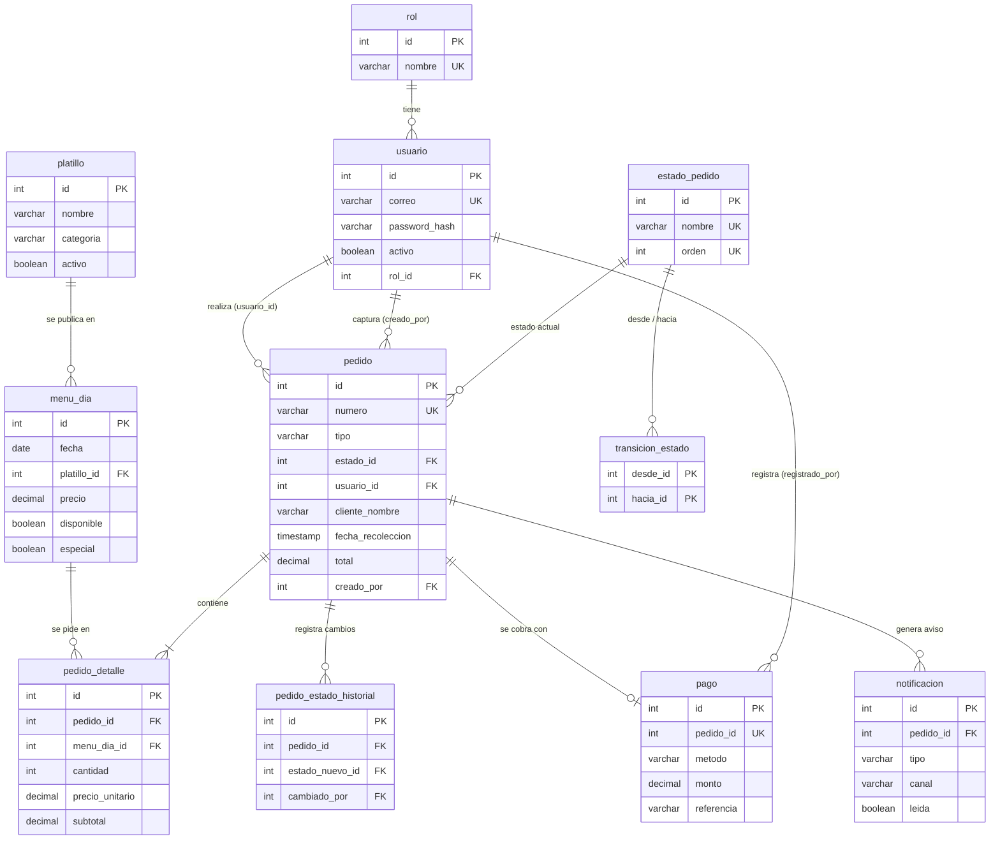

# Data Model: Fundamentos y Autenticación (Sprint 1)

**Feature**: `specs/002-foundation-auth/` | **Date**: 2026-10-13

Las tablas `rol` y `usuario` ya existen en `migrations/001_crear_esquema.sql`;
aquí se fija su uso para auth más la única tabla nueva del sprint. Sin cambios
al esquema de menú/pedidos/pagos/notificaciones (fuera de alcance).

## Rol (existente, solo lectura en este sprint)

Catálogo en `rol(id, nombre, creado_en)`. Valores del seed: `administrador`,
`cajero`, `cocinero`, `usuario` (este último = cliente alumno/docente).

- El registro público solo puede asignar `usuario`; cualquier otro valor se
  rechaza aunque venga en la petición.
- El frontend mapea `usuario` → módulos `/menu`, `/mis-pedidos`.

## Usuario (existente; escritura: registro + gestión admin)

`usuario(id, nombre, correo UNIQUE, password_hash, activo, rol_id → rol,
creado_en, actualizado_en)`.

Reglas del sprint (traza a FR-001…FR-008 de la spec):

- `correo`: único, formato válido, se normaliza a minúsculas y sin espacios.
- `password_hash`: hash `bcryptjs` (costo 10 dev / 12 prod); la contraseña en
  claro NUNCA se persiste ni se devuelve en ninguna respuesta.
- `activo = FALSE` impide iniciar sesión (mensaje genérico, igual que
  credenciales inválidas).
- Solo `administrador` crea cuentas con rol `cajero`/`cocinero` y edita
  `rol_id`/`activo`; nadie puede elevar su propio rol vía registro.
- Listados de admin NUNCA incluyen `password_hash`.

## Sesión (sin tabla; JWT firmado)

Claims: `sub` (id de usuario), `rol` (nombre), `iat`, `exp` (8 h por defecto,
configurable). El backend revalida en cada petición: firma, expiración,
`activo = TRUE` y rol vigente en BD (un cambio de rol/desactivación invalida
el acceso aunque el token siga vigente).

## schema_migrations (nueva; única tabla del sprint)

`schema_migrations(nombre VARCHAR(100) PRIMARY KEY, aplicado_en TIMESTAMP)`.
La registra el corredor R5; `001` y `002` quedan marcados al aplicarse sobre
una BD existente (idempotente por `CREATE TABLE IF NOT EXISTS` del corredor,
no por los SQL actuales — el corredor verifica antes de ejecutar).

## Cuentas iniciales (vía script R6, no SQL)

Admin, cajero y cocinero se crean con el script de seed por variables de
entorno; en desarrollo usan valores por defecto documentados en
`quickstart.md`. Los clientes se autorregistran desde el sprint 1.

## Diagrama ER del esquema completo (migraciones 001, 003 y 004)

Vista de conjunto de las 12 tablas del sistema. Solo documenta lo que ya
existe en `migrations/`; no agrega ni cambia nada del esquema.

`schema_migrations` (migración 003) registra las migraciones aplicadas y no se
relaciona con las demás. `pedido.tipo` es `anticipado` o `mostrador`;
`pago.metodo` es `online` o `efectivo`.
